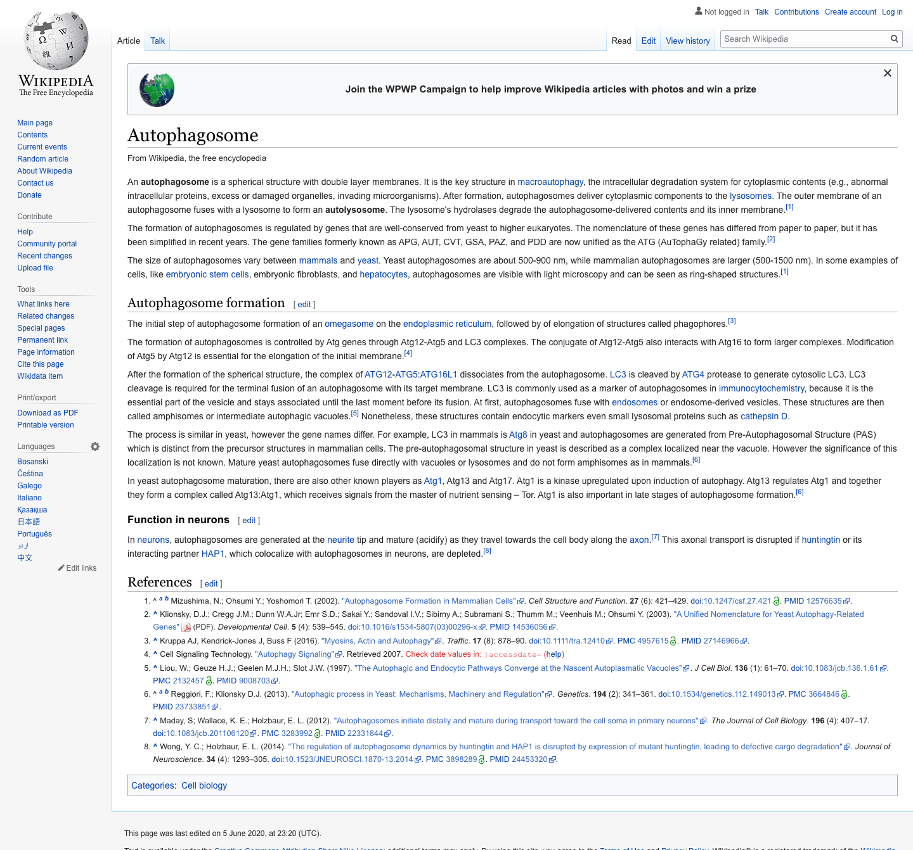
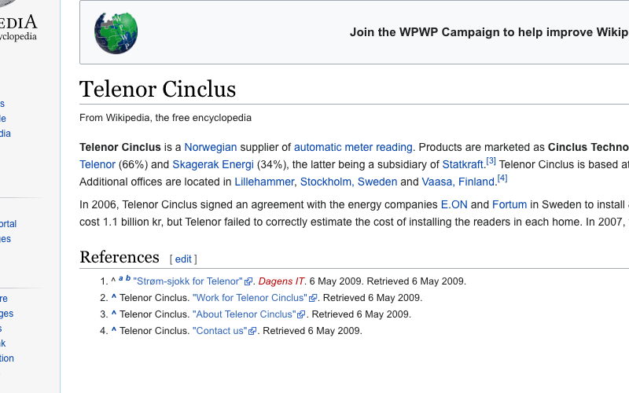

# Full page and clipped screenshots

By default, a screenshot shows what fits into the browser window. This page shows how to capture the whole page, or only an area of it.

## What you need

- An API token ([Authentication](/guide/api/introduction/authentication))
- A plan or credits for full page screenshots. The [free plan](/guide/api/introduction/free-plan) doesn't include `full_page`.

## Capture the whole page

Set `full_page` to `true`. Set `window_width` too, so the page uses the layout you expect.



::: code-group

```bash [curl]
curl --request POST \
  --url https://3.screeenly.com/api/v1/shots \
  --header 'Accept: application/json' \
  --header 'Authorization: Bearer YOUR_API_TOKEN' \
  --data url=https://example.com \
  --data window_width=1440 \
  --data full_page=1
```

```php [PHP]
use Illuminate\Support\Facades\Http;

$response = Http::withToken('YOUR_API_TOKEN')
    ->acceptJson()
    ->post('https://3.screeenly.com/api/v1/shots', [
        'url' => 'https://example.com',
        'window_width' => 1440,
        'full_page' => true,
    ]);
```

```js [JavaScript]
const response = await fetch('https://3.screeenly.com/api/v1/shots', {
    method: 'POST',
    headers: {
        Accept: 'application/json',
        Authorization: 'Bearer YOUR_API_TOKEN',
        'Content-Type': 'application/json',
    },
    body: JSON.stringify({ url: 'https://example.com', window_width: 1440, full_page: true }),
});
```

```python [Python]
import requests

response = requests.post(
    "https://3.screeenly.com/api/v1/shots",
    headers={"Accept": "application/json", "Authorization": "Bearer YOUR_API_TOKEN"},
    json={"url": "https://example.com", "window_width": 1440, "full_page": True},
)
```

:::

- With `full_page`, `window_height` is optional.
- `full_page` can't be combined with `selector` or the `clip_*` options. Leave it out completely, don't send `full_page: false`.
- Images that load on scroll may be missing. See [Troubleshooting](/guide/faq/troubleshooting#images-further-down-the-page-are-missing).
- Chrome can't capture images higher than 16,384 pixels. Very long pages can come back cut off or blank.

## Capture one element

Send a CSS `selector` to capture only that element:

```json
{
    "url": "https://example.com",
    "window_width": 1440,
    "window_height": 900,
    "selector": "main"
}
```

If the selector matches no element, the request fails with a `400` error.

## Capture an area

Send `clip_x`, `clip_y`, `clip_width` and `clip_height` together. This example captures an area 800 pixels wide and 500 pixels high, 100 pixels from the left and from the top of the page.



::: code-group

```bash [curl]
curl --request POST \
  --url https://3.screeenly.com/api/v1/shots \
  --header 'Accept: application/json' \
  --header 'Authorization: Bearer YOUR_API_TOKEN' \
  --data url=https://example.com \
  --data window_width=1440 \
  --data window_height=1200 \
  --data clip_x=100 \
  --data clip_y=100 \
  --data clip_width=800 \
  --data clip_height=500
```

```php [PHP]
use Illuminate\Support\Facades\Http;

$response = Http::withToken('YOUR_API_TOKEN')
    ->acceptJson()
    ->post('https://3.screeenly.com/api/v1/shots', [
        'url' => 'https://example.com',
        'window_width' => 1440,
        'window_height' => 1200,
        'clip_x' => 100,
        'clip_y' => 100,
        'clip_width' => 800,
        'clip_height' => 500,
    ]);
```

```js [JavaScript]
const response = await fetch('https://3.screeenly.com/api/v1/shots', {
    method: 'POST',
    headers: {
        Accept: 'application/json',
        Authorization: 'Bearer YOUR_API_TOKEN',
        'Content-Type': 'application/json',
    },
    body: JSON.stringify({
        url: 'https://example.com',
        window_width: 1440,
        window_height: 1200,
        clip_x: 100,
        clip_y: 100,
        clip_width: 800,
        clip_height: 500,
    }),
});
```

```python [Python]
import requests

response = requests.post(
    "https://3.screeenly.com/api/v1/shots",
    headers={"Accept": "application/json", "Authorization": "Bearer YOUR_API_TOKEN"},
    json={
        "url": "https://example.com",
        "window_width": 1440,
        "window_height": 1200,
        "clip_x": 100,
        "clip_y": 100,
        "clip_width": 800,
        "clip_height": 500,
    },
)
```

:::

## Related

- [Screenshots and PDFs](/guide/api/available-endpoints/shots)
- [All options](/guide/api/available-endpoints/options)
